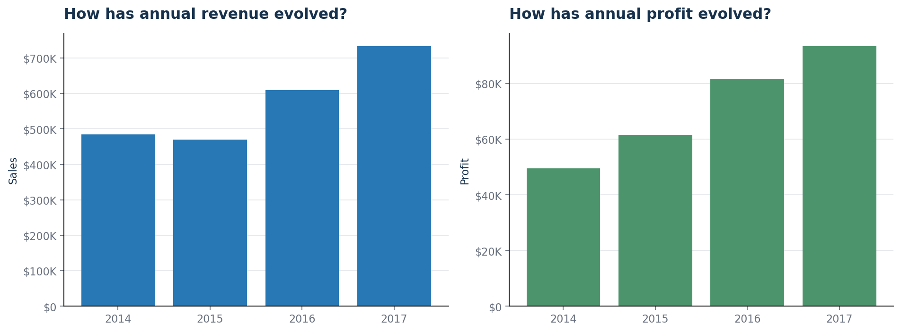
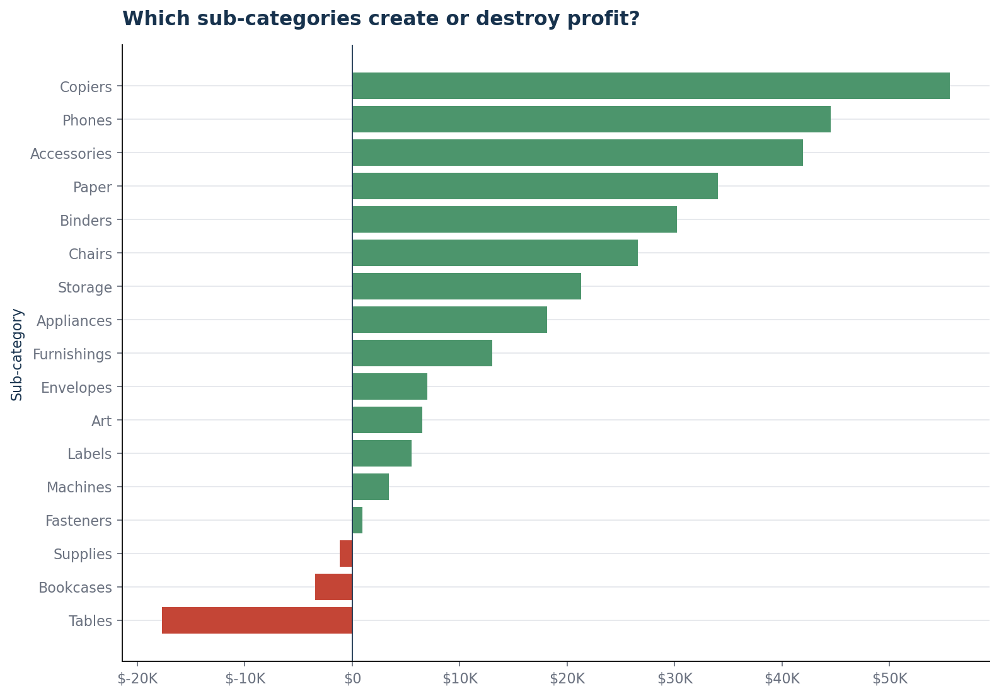
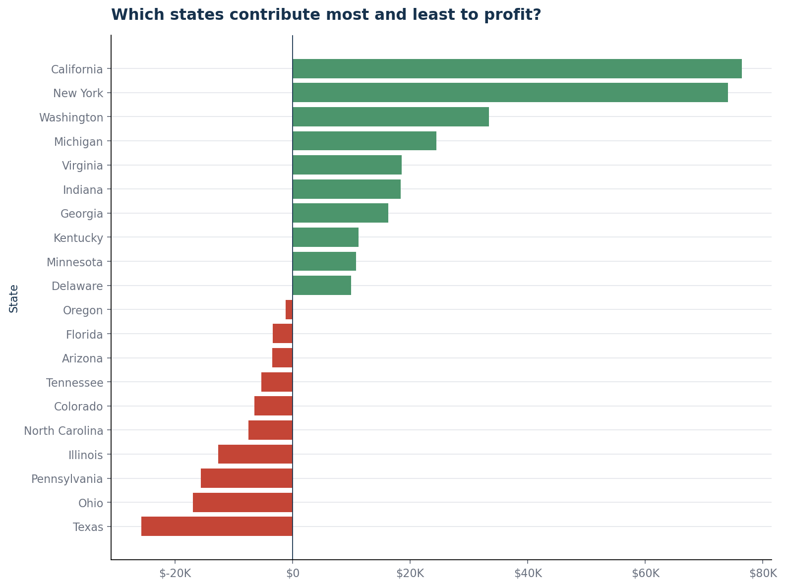
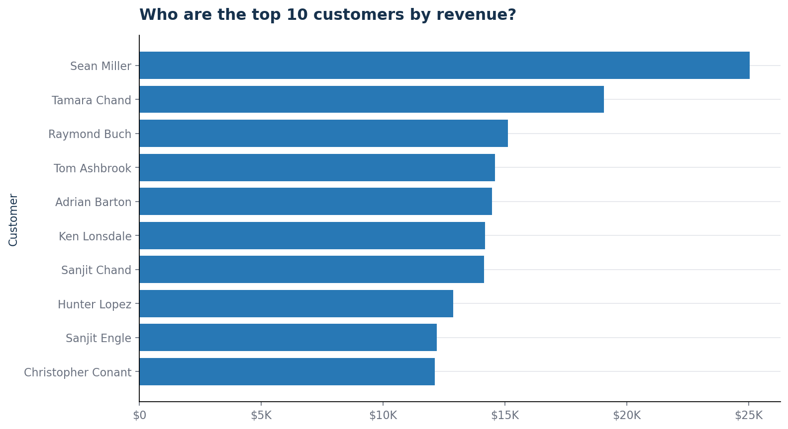

# Retail Sales Analysis

Analyse complète des ventes d'une entreprise de distribution américaine, réalisée
avec Python et Excel. Le projet transforme un fichier commercial brut en
indicateurs de performance, visualisations décisionnelles et recommandations
destinées à une direction commerciale.

## Présentation du projet

Ce projet analyse les données **Sample Superstore** afin d'évaluer la croissance,
la rentabilité et les principaux leviers de performance de l'entreprise entre
2014 et 2017.

L'analyse couvre l'ensemble du cycle de travail d'un Data Analyst :

- compréhension du besoin métier ;
- exploration et contrôle de la qualité des données ;
- nettoyage reproductible ;
- calcul des KPI ;
- analyse temporelle, commerciale et géographique ;
- création de visualisations ;
- formulation de conclusions et de recommandations.

Les données originales sont conservées intactes. Toutes les transformations sont
appliquées à une copie enregistrée dans `data/processed/`.

## Contexte métier

La direction commerciale souhaite comprendre les facteurs qui influencent le
chiffre d'affaires et le profit. Une progression des ventes ne garantit pas
nécessairement une amélioration de la rentabilité : les remises, le mix produit
et les écarts entre régions peuvent réduire fortement les marges.

L'analyse doit donc répondre aux questions suivantes :

- Comment le chiffre d'affaires et le profit évoluent-ils dans le temps ?
- Quelles catégories et sous-catégories créent le plus de valeur ?
- Quels produits détruisent de la marge ?
- Quelles régions et quels États sont les plus performants ?
- Quel est l'impact des remises sur la rentabilité ?
- Qui sont les principaux clients ?
- Quelles actions peuvent améliorer la performance commerciale ?

## Objectifs

1. Produire un jeu de données nettoyé et documenté.
2. Construire des KPI fiables pour le pilotage commercial.
3. Identifier les produits, clients et zones géographiques performants.
4. Détecter les activités générant des pertes.
5. Mesurer la relation entre remises et rentabilité.
6. Présenter les résultats dans un rapport et un classeur Excel exploitables.
7. Formuler des recommandations concrètes pour la direction.

## Dataset

Le projet utilise le jeu de données **Sample Superstore**, qui contient les
commandes d'une entreprise de distribution aux États-Unis.

| Caractéristique | Valeur |
|:--|--:|
| Période analysée | 2014-01-03 au 2017-12-30 |
| Lignes | 9 994 |
| Colonnes brutes | 21 |
| Commandes uniques | 5 009 |
| Clients uniques | 793 |
| Produits uniques | 1 862 |
| Régions | 4 |
| Catégories | 3 |
| Sous-catégories | 17 |
| Valeurs manquantes | 0 |
| Doublons potentiels signalés | 2 lignes |

Les variables principales sont les dates de commande et d'expédition, le client,
le segment, la localisation, le produit, les ventes, les quantités, les remises
et le profit.

## Technologies utilisées

- **Python**
- **Pandas** pour la manipulation et l'agrégation des données
- **NumPy** pour les calculs analytiques
- **Matplotlib** pour les visualisations
- **OpenPyXL** pour la génération du classeur Excel
- **Jupyter Notebook** pour l'exploration initiale
- **Excel** pour la consultation et le partage des résultats
- **HTML, CSS et JavaScript** pour le dashboard web interactif
- **Power BI** pour le dashboard exécutif
- **Markdown** pour la documentation

## Architecture du projet

Le projet sépare les données sources, les données transformées, le code, les
rapports et les visualisations.

```text
Retail-Sales-Analysis/
├── data/
│   ├── raw/
│   │   └── Sample - Superstore.csv
│   └── processed/
│       ├── superstore_clean.csv
│       └── business_kpis.csv
├── notebooks/
│   └── 01_data_exploration.ipynb
├── reports/
│   ├── data_exploration.md
│   ├── data_cleaning_report.md
│   ├── business_analysis.md
│   └── retail_sales_analysis.xlsx
├── scripts/
│   ├── explore.py
│   ├── clean_data.py
│   └── analyze_sales.py
├── visuals/
│   ├── 01_annual_performance.png
│   ├── 02_monthly_sales_trend.png
│   ├── 03_category_performance.png
│   ├── 04_subcategory_profit.png
│   ├── 05_region_performance.png
│   ├── 06_discount_profitability.png
│   ├── 07_state_profit_extremes.png
│   └── 08_top_customers.png
├── dashboard/
│   ├── web/
│   │   ├── index.html
│   │   ├── styles.css
│   │   └── app.js
│   ├── retail_dashboard_background.png
│   ├── retail_executive_theme.json
│   ├── power_query_sales.m
│   ├── measures.dax
│   └── README.md
├── PROJECT_INSTRUCTIONS.md
└── README.md
```

## Dashboard interactif

Le dashboard final est disponible pour le navigateur et sous forme de kit
Power BI. Les instructions de lancement et d’assemblage se trouvent dans
[`dashboard/README.md`](dashboard/README.md).

## Workflow

### 1. Exploration

- contrôle des dimensions et des types ;
- analyse des valeurs manquantes ;
- recherche de doublons ;
- validation des dates ;
- contrôle des variables numériques ;
- identification des incohérences de format.

Le rapport correspondant est disponible dans
[`reports/data_exploration.md`](reports/data_exploration.md).

### 2. Nettoyage

- conversion des dates au format `datetime` ;
- conversion du code postal en identifiant textuel ;
- suppression des espaces périphériques ;
- ajout de l'indicateur `Potential Duplicate` ;
- conservation de toutes les lignes pour assurer la traçabilité ;
- export du fichier nettoyé sans modifier la source.

Les transformations sont détaillées dans
[`reports/data_cleaning_report.md`](reports/data_cleaning_report.md).

### 3. Analyse métier

- calcul des KPI globaux ;
- analyse annuelle et mensuelle ;
- analyse des catégories et sous-catégories ;
- analyse régionale et par État ;
- étude des remises et des marges ;
- classement des clients et des produits ;
- analyse des modes et délais de livraison.

### 4. Restitution

- export des KPI au format CSV ;
- création de huit graphiques décisionnels ;
- génération d'un classeur Excel de 12 feuilles ;
- rédaction d'un rapport métier avec recommandations.

## KPIs

| KPI | Résultat |
|:--|--:|
| Chiffre d'affaires | **2 297 200,86 $** |
| Profit total | **286 397,02 $** |
| Marge bénéficiaire | **12,5 %** |
| Nombre de commandes | **5 009** |
| Nombre de clients | **793** |
| Unités vendues | **37 873** |
| Panier moyen | **458,61 $** |
| Remise moyenne | **15,6 %** |
| Délai moyen d'expédition | **3,96 jours** |
| Taux de clients récurrents | **98,5 %** |
| Part des ventes à perte | **20,4 %** |
| Croissance annuelle composée des ventes | **14,8 %** |
| Croissance des ventes en 2017 | **20,4 %** |
| Croissance du profit en 2017 | **14,2 %** |

La liste complète et réutilisable est disponible dans
[`data/processed/business_kpis.csv`](data/processed/business_kpis.csv).

## Principaux résultats

### Croissance

- Le chiffre d'affaires atteint son niveau maximal en 2017 avec **733 215 $**.
- Les ventes progressent de **20,4 %** en 2017.
- Le profit progresse de **14,2 %** sur la même période.
- La marge de 2017 s'établit à **12,7 %**.

### Produits

- **Technology** est la catégorie la plus rentable avec **145 455 $** de profit.
- **Furniture** réalise **742 000 $** de ventes, mais seulement **2,5 %** de marge.
- Les sous-catégories les plus rentables sont **Copiers**, **Phones** et
  **Accessories**.
- **Tables**, **Bookcases** et **Supplies** enregistrent un profit négatif.
- La sous-catégorie **Tables** génère à elle seule une perte de **17 725 $**.

### Géographie

- La région **West** génère le profit le plus élevé : **108 418 $**.
- La région **Central** présente la marge régionale la plus faible : **7,9 %**.
- Les pertes les plus importantes sont observées au **Texas**, dans l'**Ohio**,
  en **Pennsylvanie**, dans l'**Illinois** et en **Caroline du Nord**.

### Remises

- Les ventes bénéficiant de plus de 40 % de remise représentent **128 632 $**.
- Elles génèrent une perte cumulée de **99 559 $**.
- Les marges deviennent négatives dès la tranche de remise **21-40 %**.

### Clients

- Les dix premiers clients représentent **6,7 %** du chiffre d'affaires.
- Le portefeuille est donc peu dépendant d'un nombre limité de grands comptes.
- **98,5 %** des clients ont passé plus d'une commande sur la période.

## Recommandations

1. **Encadrer les remises élevées** avec un seuil d'approbation et une marge
   minimale attendue avant validation.
2. **Redresser les sous-catégories déficitaires**, en priorité `Tables`,
   `Bookcases` et `Supplies`, en révisant prix, coûts et politique promotionnelle.
3. **Construire un plan d'action géographique** pour les États générant les
   pertes les plus importantes.
4. **Protéger les moteurs de profit** en sécurisant les stocks et la promotion
   des produits `Copiers`, `Phones` et `Accessories`.
5. **Piloter les équipes sur la marge**, et pas uniquement sur le chiffre
   d'affaires.
6. **Segmenter les clients récurrents** selon leur valeur, leur fréquence
   d'achat et leur sensibilité aux remises.

## Structure des dossiers

| Dossier | Rôle |
|:--|:--|
| `data/raw/` | Données originales, jamais modifiées |
| `data/processed/` | Données nettoyées et exports KPI |
| `notebooks/` | Exploration interactive |
| `scripts/` | Pipelines Python reproductibles |
| `reports/` | Rapports Markdown et classeur Excel |
| `visuals/` | Graphiques exportés au format PNG |

## Comment lancer le projet

### Prérequis

- Python 3.10 ou version ultérieure
- `pip`

### Installation

Depuis la racine du projet :

```bash
python -m pip install pandas numpy matplotlib openpyxl jupyter
```

### Exploration

```bash
jupyter notebook notebooks/01_data_exploration.ipynb
```

### Nettoyage des données

```bash
python scripts/clean_data.py
```

Cette commande génère :

- `data/processed/superstore_clean.csv`
- `reports/data_cleaning_report.md`

### Analyse et génération des livrables

```bash
python scripts/analyze_sales.py
```

Cette commande génère automatiquement :

- le fichier des KPI ;
- les huit graphiques ;
- le rapport d'analyse métier ;
- le classeur Excel.

## Aperçu des graphiques

### Évolution annuelle



### Tendance mensuelle


### Performance des catégories


### Rentabilité des sous-catégories



### Performance régionale


### Impact des remises


### États les plus et les moins rentables



### Principaux clients



## Livrables principaux

- [Rapport d'exploration](reports/data_exploration.md)
- [Rapport de nettoyage](reports/data_cleaning_report.md)
- [Rapport d'analyse métier](reports/business_analysis.md)
- [Classeur Excel](reports/retail_sales_analysis.xlsx)
- [Dataset nettoyé](data/processed/superstore_clean.csv)
- [Fichier des KPI](data/processed/business_kpis.csv)

## Limites

- Les données couvrent uniquement le marché américain et la période 2014-2017.
- Aucun détail de coût autre que le profit fourni n'est disponible.
- Deux lignes sont conservées comme doublons potentiels en attente d'une
  validation métier.
- Les associations observées entre remises et pertes ne démontrent pas, à elles
  seules, une relation causale.
