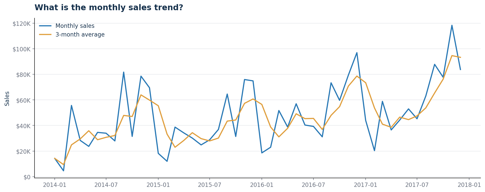
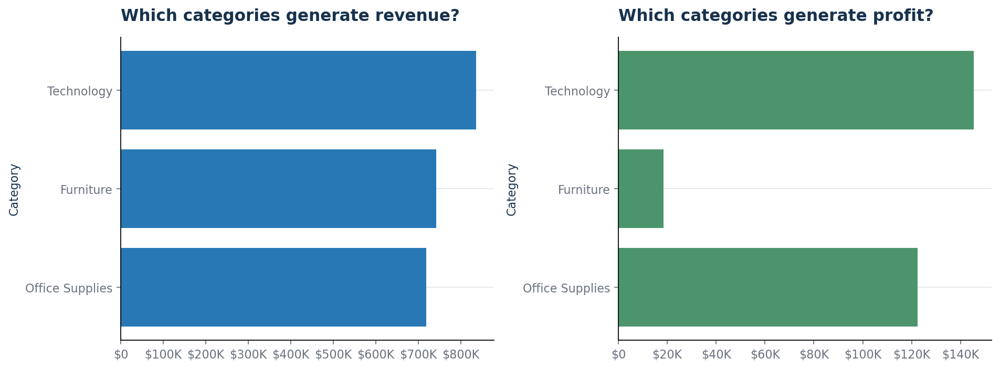
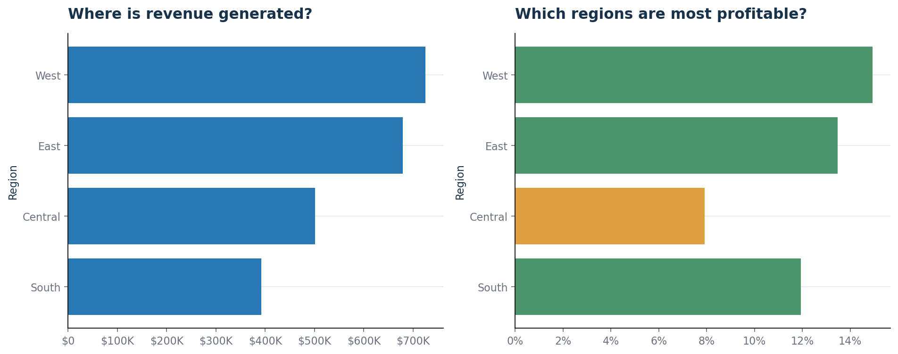
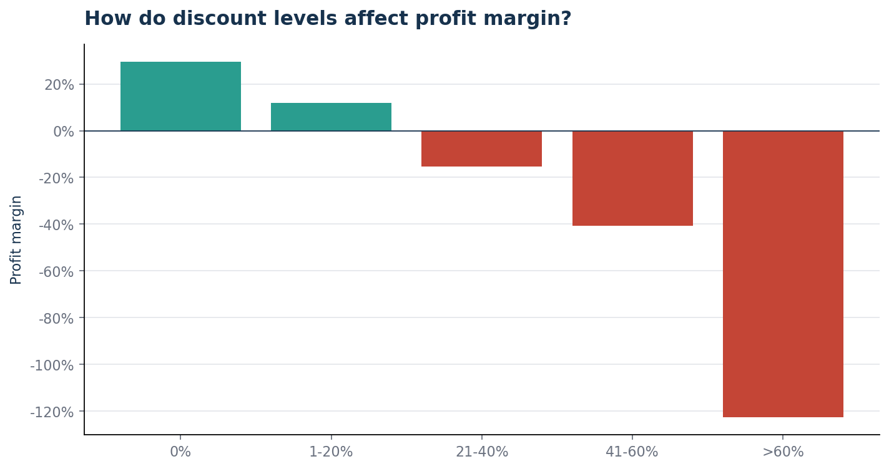

# 03 · Analyse des ventes d'un distributeur américain

[Site du portfolio](https://temidossoukitti-cpu.github.io/DATA-ANALYTICS-PORTFOLIO/) · [Retour à l'index](../../README.md)

> **Données publiques** : jeu de données *Sample Superstore* (commandes d'un distributeur américain, 2014-2017).

Analyse complète réalisée avec Python et Excel : un fichier commercial brut est transformé en indicateurs de performance, visualisations décisionnelles et recommandations pour une direction commerciale.

## Question de gestion
Une hausse des ventes ne garantit pas une meilleure rentabilité : les remises, le mix produit et les écarts entre régions peuvent réduire fortement les marges. Quels facteurs influencent le chiffre d'affaires et le profit, et quelles actions améliorent la performance commerciale ?

## Résumé en 60 secondes
- Le chiffre d'affaires atteint **2,30 M$** et le profit **286 397 $**, soit une marge de **12,5 %**.
- Les ventes progressent de **20,4 %** en 2017, le profit de **14,2 %**.
- **20,4 %** des ventes sont réalisées à perte, surtout à cause des **remises élevées** : au-delà de 40 % de remise, les ventes cumulent **99 559 $ de perte**.
- **Tables**, **Bookcases** et **Supplies** détruisent de la marge ; **Technology** est la catégorie la plus rentable (**145 455 $**).

## Données
| Caractéristique | Valeur |
|:--|--:|
| Période analysée | 2014-01-03 au 2017-12-30 |
| Lignes | 9 994 |
| Colonnes brutes | 21 |
| Commandes uniques | 5 009 |
| Clients uniques | 793 |
| Produits uniques | 1 862 |
| Régions · Catégories · Sous-catégories | 4 · 3 · 17 |
| Valeurs manquantes | 0 |
| Doublons potentiels signalés | 2 lignes |

Les données originales restent intactes dans `data/raw/` ; toutes les transformations sont appliquées à une copie dans `data/processed/`.

## Méthode
1. **Exploration** : dimensions, types, valeurs manquantes, doublons, dates, variables numériques ([rapport](reports/data_exploration.md)).
2. **Nettoyage reproductible** : dates au format `datetime`, code postal en texte, espaces retirés, indicateur `Potential Duplicate`, toutes les lignes conservées ([rapport](reports/data_cleaning_report.md)).
3. **Analyse métier** : KPI globaux, évolution annuelle et mensuelle, catégories, régions et États, remises et marges, clients, délais de livraison.
4. **Restitution** : KPI en CSV, 8 graphiques, classeur Excel de 12 feuilles, rapport avec recommandations.

## KPI
| KPI | Résultat |
|:--|--:|
| Chiffre d'affaires | **2 297 200,86 $** |
| Profit total | **286 397,02 $** |
| Marge bénéficiaire | **12,5 %** |
| Nombre de commandes | **5 009** |
| Nombre de clients | **793** |
| Unités vendues | **37 873** |
| Panier moyen | **458,61 $** |
| Remise moyenne | **15,6 %** |
| Délai moyen d'expédition | **3,96 jours** |
| Taux de clients récurrents | **98,5 %** |
| Part des ventes à perte | **20,4 %** |
| Croissance annuelle composée des ventes | **14,8 %** |

Liste complète : [`data/processed/business_kpis.csv`](data/processed/business_kpis.csv).

## Résultats clés

**Croissance** : le chiffre d'affaires est maximal en 2017 (**733 215 $**), avec une marge de **12,7 %**.

**Produits** : Technology est la plus rentable ; Furniture réalise **742 000 $** de ventes pour seulement **2,5 %** de marge. Copiers, Phones et Accessories sont les sous-catégories les plus rentables ; Tables à elle seule perd **17 725 $**.

**Géographie** : West génère le profit le plus élevé (**108 418 $**), Central la marge la plus faible (**7,9 %**). Les plus fortes pertes viennent du Texas, de l'Ohio, de la Pennsylvanie, de l'Illinois et de la Caroline du Nord.

**Remises** : les ventes à plus de 40 % de remise représentent **128 632 $** et génèrent **99 559 $** de perte ; les marges deviennent négatives dès la tranche 21-40 %.

**Clients** : les dix premiers clients pèsent **6,7 %** du chiffre d'affaires, donc peu de dépendance à de grands comptes ; **98,5 %** des clients ont commandé plus d'une fois.

## Recommandations
1. **Encadrer les remises élevées** par un seuil d'approbation et une marge minimale avant validation.
2. **Redresser les sous-catégories déficitaires** (Tables, Bookcases, Supplies) : prix, coûts et politique promotionnelle.
3. **Plan d'action géographique** pour les États qui perdent le plus d'argent.
4. **Protéger les moteurs de profit** : sécuriser stocks et promotion de Copiers, Phones et Accessories.
5. **Piloter les équipes sur la marge**, pas seulement sur le chiffre d'affaires.
6. **Segmenter les clients récurrents** selon leur valeur, leur fréquence d'achat et leur sensibilité aux remises.

## Limites
- Données limitées au marché américain et à la période 2014-2017.
- Aucun détail de coût autre que le profit fourni.
- Deux lignes conservées comme doublons potentiels, en attente d'une validation métier.
- Les liens observés entre remises et pertes ne prouvent pas une relation causale.

## Aperçu des graphiques

| | |
|:--|:--|
|  |  |
|  |  |
|  |  |
|  |  |

## Dashboard
Version web (navigateur) et kit Power BI : consignes de lancement et d'assemblage dans [`dashboard/README.md`](dashboard/README.md).

## Reproduire l'analyse
Prérequis : Python 3.10+ et `pip`. Depuis **ce dossier** (`projects/03-ventes-retail`) :

```bash
python -m pip install pandas numpy matplotlib openpyxl jupyter
python scripts/clean_data.py      # génère data/processed/superstore_clean.csv et le rapport de nettoyage
python scripts/analyze_sales.py   # génère les KPI, les 8 graphiques, le rapport et le classeur Excel
jupyter notebook notebooks/01_data_exploration.ipynb   # exploration
```

## Contenu du dossier
```text
projects/03-ventes-retail/
├── data/          # raw/ (jamais modifié) et processed/
├── notebooks/     # exploration interactive
├── scripts/       # explore.py · clean_data.py · analyze_sales.py
├── reports/       # rapports Markdown et classeur Excel
├── visuals/       # 8 graphiques PNG
├── dashboard/     # version web, thème et mesures pour Power BI
└── requirements.txt
```

## Livrables
[Rapport d'exploration](reports/data_exploration.md) · [Rapport de nettoyage](reports/data_cleaning_report.md) · [Rapport d'analyse métier](reports/business_analysis.md) · [Classeur Excel](reports/retail_sales_analysis.xlsx) · [Dataset nettoyé](data/processed/superstore_clean.csv) · [KPI](data/processed/business_kpis.csv)

## Auteur

**Samuel DOSSOU-KITTI** · [temidossoukitti@gmail.com](mailto:temidossoukitti@gmail.com)
