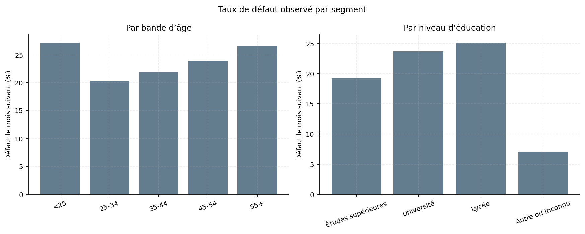
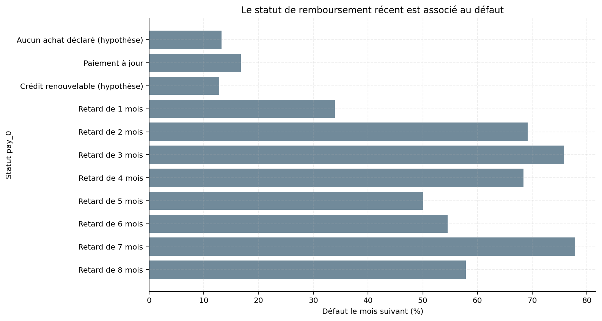
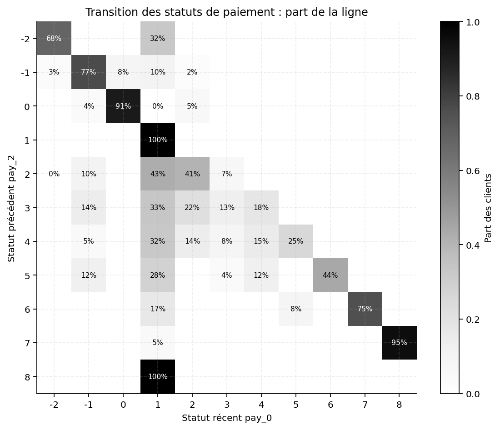
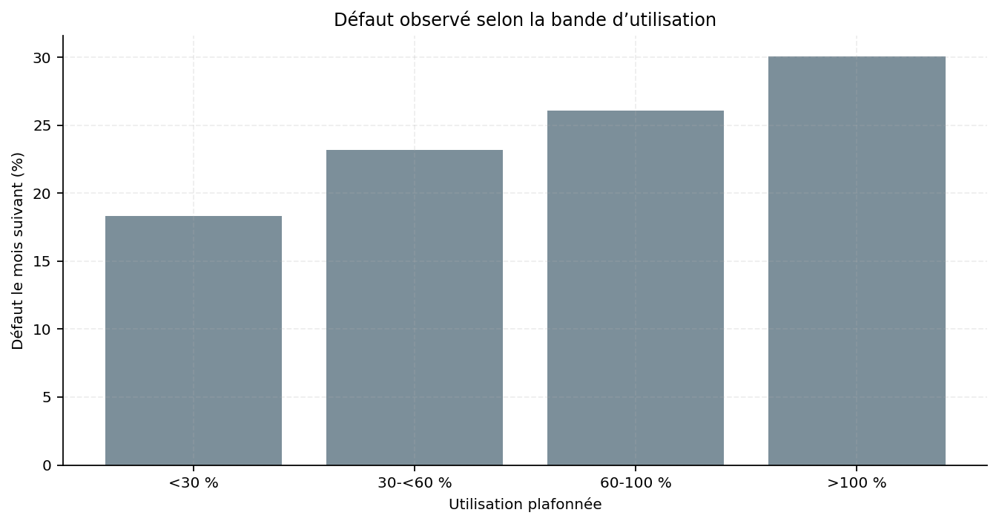
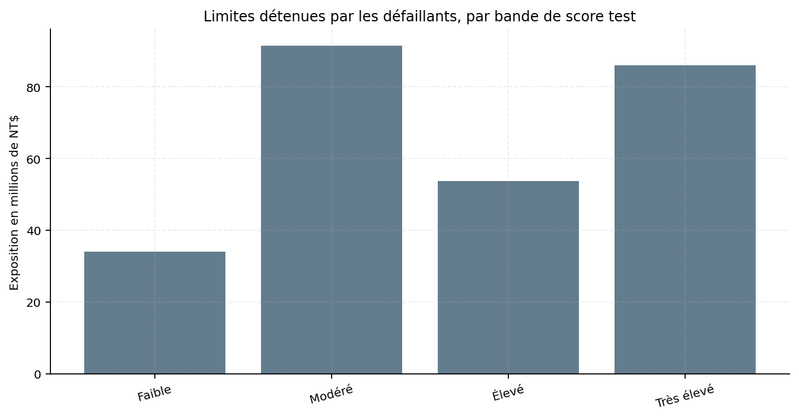
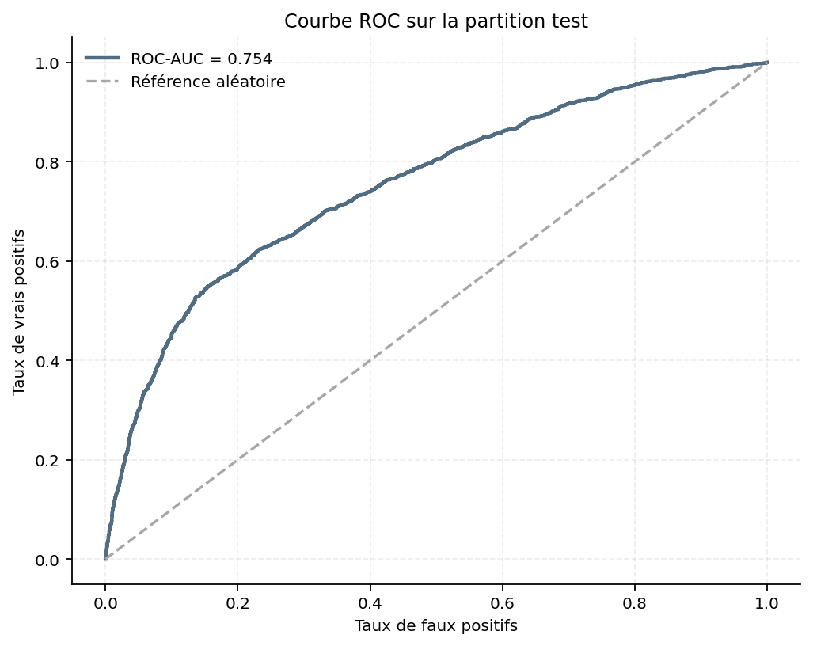
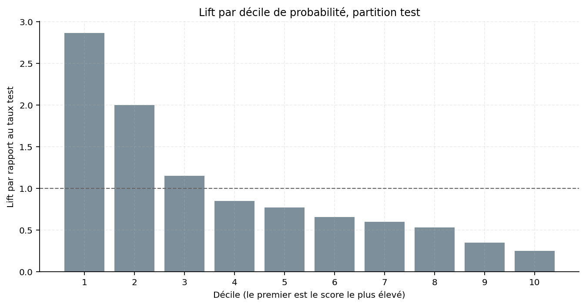
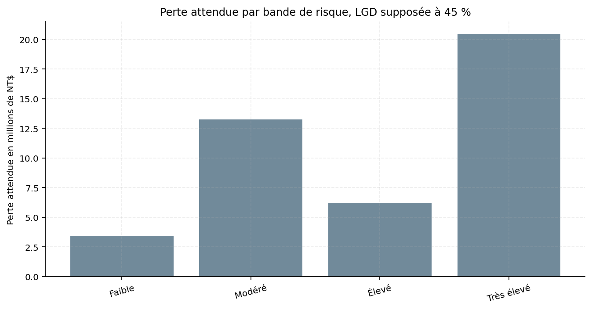

# 04 · Risque de défaut des cartes de crédit

[](../../)

[← Retour à l’index du portfolio](../../)

**Données publiques :** [UCI Machine Learning Repository — Default of Credit Card Clients](https://archive.ics.uci.edu/dataset/350/default+of+credit+card+clients), Yeh (2009), DOI [10.24432/C55S3H](https://doi.org/10.24432/C55S3H). Licence **CC BY 4.0** : redistribution et adaptation autorisées avec attribution. Citation complète et empreinte du fichier dans [`data/raw/SOURCE.md`](data/raw/SOURCE.md).

## Question de gestion

Quels profils de clients de cartes de crédit font défaut le mois suivant, et comment ajuster les limites de crédit et les actions de relance pour réduire les pertes ?

## Résumé en 60 secondes

<!-- DYNAMIQUE_SUMMARY_BEGIN -->
- **Cohorte traitée :** 30 000 clients issus de 25 colonnes; 0 valeur manquante brute.
- **Niveau de défaut :** 22,12 % sur la cohorte; limites totales de NT$ 5 024 529 680 et exposition des défaillants de NT$ 863 407 680.
- **Modèle test :** ROC-AUC 0,7536, PR-AUC 0,5016, KS 0,3948; précision 45,32 % et rappel 58,81 % au seuil 0,25.
- **Livrables :** 8 tables chargées (7 en étoile et une scorecard), 14 mesures DAX, 4 pages planifiées et 8 graphiques; part test à risque élevé 31,89 %.
<!-- DYNAMIQUE_SUMMARY_END -->

## Données et contrôle qualité

Le classeur XLS original est conservé intact dans `data/raw/`. Les codes non documentés par UCI sont présentés comme des hypothèses métier, pas comme des faits source. Le détail des colonnes, recodages, périodes et unités est dans [`DATA_DICTIONARY.md`](data/raw/DATA_DICTIONARY.md).

<!-- DYNAMIQUE_DATA_BEGIN -->
Contrôles automatisés : **16/16 PASS**; 70 lignes appartenant à des profils identiques hors ID comptées et conservées; 345 recodages éducation et 54 recodages matrimoniaux; aucune ligne supprimée. Voir [`results/quality_check.csv`](results/quality_check.csv) et [`qa/validation_report.md`](qa/validation_report.md).
<!-- DYNAMIQUE_DATA_END -->

## Méthode

Le pipeline lit la deuxième ligne comme en-tête métier (`header=1`), conserve les valeurs source d’éducation et d’état matrimonial, puis applique les recodages documentés dans le dictionnaire. Il calcule les bandes d’âge et de limite, l’utilisation, le ratio de paiement, les retards sur six périodes et le retard récent. Aucun client n’est supprimé.

Le modèle est une régression logistique avec séparation stratifiée, standardisation des prédicteurs numériques et encodage de l’éducation. `sex`, `marriage` et `age` sont exclus du score; les analyses qui les décrivent ne constituent pas des règles de décision. Les définitions et consignes Power BI figurent dans [`model/DATA_MODEL.md`](model/DATA_MODEL.md), [`model/DAX_MEASURES.md`](model/DAX_MEASURES.md) et [`powerbi/POWER_QUERY.md`](powerbi/POWER_QUERY.md).

<!-- DYNAMIQUE_METHOD_BEGIN -->
Séparation stratifiée : **70,00 % Train / 30,00 % Test**, `random_state=42`; seuil de classification **0,25**. Bandes de score documentées : `<0.10; 0.10-<0.20; 0.20-<0.40; >=0.40`. La perte attendue applique une LGD de base de **45,00 %** sur l’exposition facturée positive.
<!-- DYNAMIQUE_METHOD_END -->

## Résultats clés

Les indicateurs de portefeuille sont définis dans `results/metrics_summary.csv`. Les performances du modèle sont mesurées sur la partition test; elles comprennent ROC-AUC, PR-AUC, KS, précision et rappel au seuil spécifié. La table de lift, la calibration et les coefficients sont dans `results/`.

<!-- DYNAMIQUE_RESULTS_BEGIN -->
| Indicateur | Résultat | Source de référence |
|---|---:|---|
| Clients / défauts | 30 000 / 6 636 | `results/portfolio_kpis.csv` |
| Taux de défaut | 22,12 % | `results/portfolio_kpis.csv` |
| Limite moyenne | NT$ 167 484 | `results/portfolio_kpis.csv` |
| Part des limites détenue par les défaillants | 17,18 % | `results/portfolio_kpis.csv` |
| ROC-AUC / PR-AUC test | 0,7536 / 0,5016 | `results/model_metrics.csv` |
| Perte attendue test à LGD 45 % | NT$ 43 390 137 | `results/expected_loss_sensitivity.csv` |
<!-- DYNAMIQUE_RESULTS_END -->

## Recommandations

Les recommandations sont des pistes à valider par une équipe de crédit; les taux observés ne démontrent pas un effet causal. Les effectifs, taux et expositions proviennent de [`results/recommendations.csv`](results/recommendations.csv). Aucun segment sensible n’est proposé comme règle d’acceptation ou de refus.

<!-- DYNAMIQUE_RECOMMENDATIONS_BEGIN -->
| ID | Déclencheur | Clients | Défaut observé | Exposition défaillants (NT$) | Action proposée |
|---|---|---:|---:|---:|---|
| R1 | pay_0 >= 1 | 6 818 | 50,29 % | NT$ 393 030 000 | Déclencher une revue de recouvrement dès l’apparition d’un retard récent; vérifier la capacité opérationnelle avant toute généralisation. |
| R2 | utilization >= 0.60 et pay_0 >= 1 | 2 898 | 58,32 % | NT$ 155 310 000 | Soumettre les demandes de hausse de limite à une revue manuelle pour ce segment; ne pas bloquer automatiquement les clients. |
| R3 | Bande très élevée, PD >= 0.40, partition test | 1 611 | 56,18 % | NT$ 86 080 000 | Prioriser ces dossiers pour une revue humaine et une relance adaptée; seuils de bandes considérés comme hypothèses de triage. |
| R4 | Bande de limite Q1, partition complète | 7 676 | 31,79 % | NT$ 80 900 000 | Examiner la politique de limite et la composition de cette bande avant toute modification; le taux observé ne démontre pas un effet causal. |
<!-- DYNAMIQUE_RECOMMENDATIONS_END -->

## Limites

La cohorte est historique, taïwanaise et datée de 2005; sa transposition à une autre population ou période n’est pas établie. Les codes `-2` et `0` des variables `pay_*` reposent sur des hypothèses documentées. Les seuils de score sont des seuils de triage illustratifs. La perte attendue utilise `bill_amt1` positif comme exposition et une LGD supposée; elle n’est ni une prévision comptable ni une estimation de perte réglementaire. Le classement et les associations ne prouvent pas de causalité. Une revue d’équité, de conformité et de calibration locale reste nécessaire avant tout usage opérationnel.

## Aperçu des graphiques

















## Statut qualité

<!-- DYNAMIQUE_STATUS_BEGIN -->
Automatisé : **PASS** · Manuel Power BI : **à faire** (20 cases non cochées; aucun test Desktop n’est revendiqué).
<!-- DYNAMIQUE_STATUS_END -->

## Dashboard

<!-- DYNAMIQUE_DASHBOARD_BEGIN -->
Plan Power BI de **4 pages** dans [`powerbi/PAGE_PLAN.md`](powerbi/PAGE_PLAN.md); le dashboard reste à construire par Samuel.
<!-- DYNAMIQUE_DASHBOARD_END -->

## Reproduire

Depuis le dossier du projet, créer un environnement Python, installer les dépendances épinglées et exécuter le pipeline :

```bash
python -m pip install -r requirements.txt
python scripts/run_all.py
```

Le pipeline régénère les CSV traités, la base SQLite, les résultats, les graphiques et le rapport de validation. Aucune entrée utilisateur ni authentification n’est nécessaire.

## Contenu du dossier

<!-- DYNAMIQUE_COUNTS_BEGIN -->
- Tables CSV traitées : **8** (7 tables en étoile et une scorecard auxiliaire).
- Mesures DAX documentées : **14**; pages planifiées : **4**; indicateurs de portefeuille : **9**.
- Recommandations chiffrées : **4**; graphiques Matplotlib : **8**.
<!-- DYNAMIQUE_COUNTS_END -->
