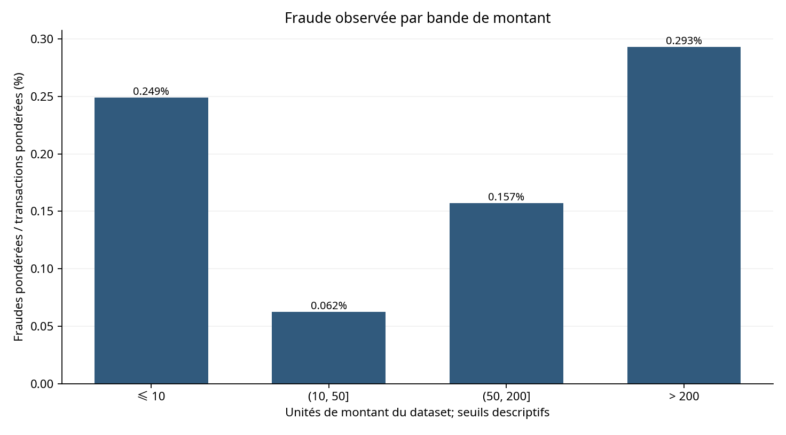
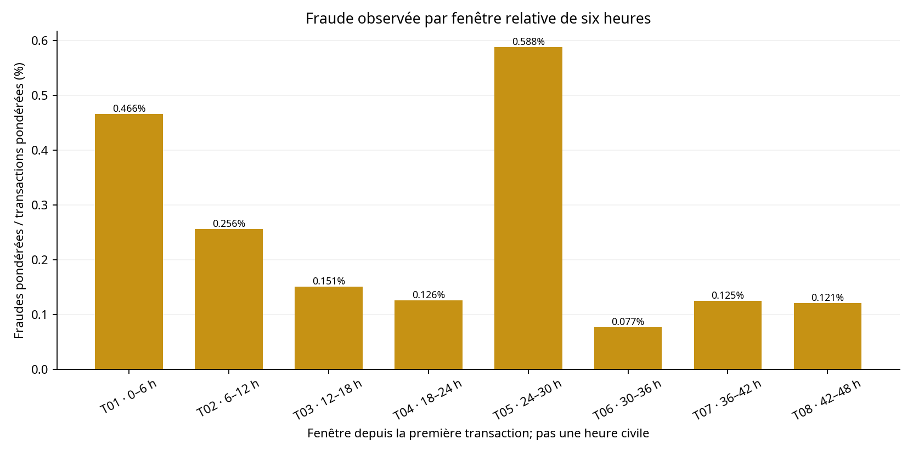
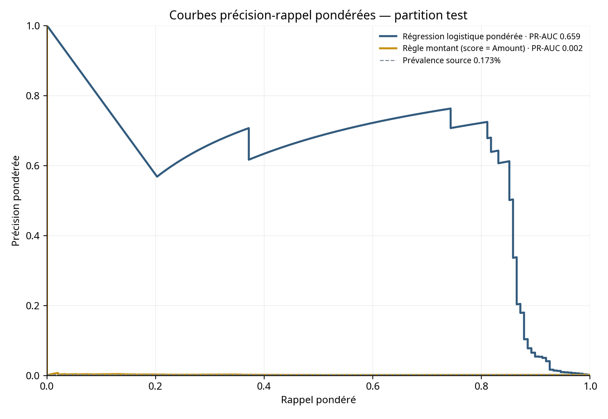
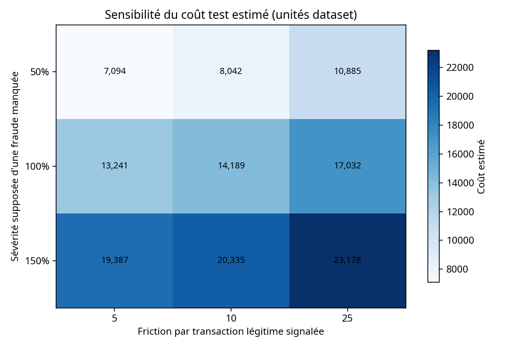

# 05 · Détection de fraude sur les transactions bancaires

[](../../)

[← Retour à l’index du portfolio](../../)

**Données publiques :** [OpenML — credit-card-fraud-detection, dataset 43627](https://www.openml.org/d/43627), Parquet officiel téléchargeable sans compte. Licence déclarée par OpenML : **ODbL 1.0 pour la base / DbCL 1.0 pour le contenu**; attribution et empreinte dans [`data/raw/SOURCE.md`](data/raw/SOURCE.md). L’échantillon redistribué conserve les notices et conditions de licence applicables.

## Question de gestion

Comment prioriser les transactions de carte susceptibles d’être frauduleuses tout en maîtrisant les faux positifs et l’exposition de fraude non détectée ? L’étude compare un score de régression logistique à une règle simple fondée sur le montant, avec un seuil explicite de coût.

## Résumé en 60 secondes

<!-- AUTO:SUMMARY_BEGIN -->
- **Population source :** 284 807 transactions, 492 fraudes (0,173 %); échantillon pondéré de 25 492 lignes.
- **Modèle (test) :** PR-AUC 0.6595, précision 67,97 %, rappel 81,76 %, seuil 0.191 choisi hors test.
- **Comparaison sous hypothèses :** coût estimé 14 189 contre 63 804 unités pour la règle de montant; exposition fraude interceptée 44 976 unités.
- **Livrables automatisés :** 8 tables Power BI, 15 mesures DAX, 4 pages planifiées, 7 graphiques, 84/84 comparaisons SQL/Python; dashboard manuel à construire.
<!-- AUTO:SUMMARY_END -->

## Données et contrôle qualité

Le Parquet complet contient des transactions de septembre 2013 sur deux jours; il fait plus de 50 Mo et n’est pas versionné. Le dépôt contient un échantillon reproductible : toutes les lignes de fraude et un tirage aléatoire de transactions légitimes, avec poids d’inclusion. La table `results/population_kpis.csv` conserve les KPI du fichier complet; `results/quality_check.csv` trace les contrôles et les doublons.

`Amount` n’a pas de devise précisée. `Time` est relatif à la première transaction. Les colonnes `V1`–`V28` sont des composantes PCA anonymisées. La source ne contient ni type/canal, ni identifiant client, ni date civile. Les doublons exacts sont comptés, conservés et groupés au split.

## Méthode

Le pipeline vérifie le schéma, les classes, les valeurs manquantes, les montants/temps impossibles, les poids d’échantillonnage et l’intégrité du modèle en étoile. Les analyses descriptives sont pondérées. Le modèle logistique standardise `V1`–`V28` et `Amount`; `Time` est exclu du modèle.

Le test est un split group-stratifié proche de 70/30, graine 42; les groupes de lignes identiques ne traversent pas les partitions. Le seuil de coût est choisi sur des prédictions hors pli du train, puis évalué sur le test. La référence est une alerte sur le 99e percentile pondéré des montants légitimes du train. Les scénarios de coût sont des hypothèses, pas des pertes comptables observées.

## Résultats clés

<!-- AUTO:KEY_RESULTS_BEGIN -->
| Indicateur | Résultat | Référence |
|---|---|---|
| Fraude source | 0,173 % (492 / 284 807) | `results/population_kpis.csv` |
| Modèle logistique | PR-AUC 0.6595; précision 67,97 %; rappel 81,76 % | `results/model_metrics.csv` |
| Règle montant P99 | rappel 2,03 %; coût 63 804 unités | `results/model_metrics.csv`; `results/money_controls.csv` |
| Modèle, coût proxy | seuil 0.191; coût 14 189 unités | `results/money_controls.csv`; `results/cost_assumptions.csv` |
| Parité SQL/Python | 84/84 PASS | `results/sql_parity.csv` |
<!-- AUTO:KEY_RESULTS_END -->

## Recommandations

<!-- AUTO:RECOMMENDATIONS_BEGIN -->
| Priorité | Recommandation | Évidence calculée |
|---:|---|---|
| 1 | Tester le modèle logistique pondéré comme file de revue plutôt que bloquer automatiquement; seuil de risque 0.191. | Test pondéré: rappel 81.8%, précision 68.0%, PR-AUC 0.659. |
| 2 | Ne pas utiliser une règle montant seule comme contrôle principal; la réserver au triage secondaire des dossiers de montant élevé. | Règle P99 à 1034.19 unités: rappel 2.0%; coût test estimé 63,804, contre 14,189 pour le modèle (rapport 4.50×). |
| 3 | Prioriser une revue renforcée des transactions de plus de 200 unités du dataset, sans ignorer les petits montants. | Bande >200: taux pondéré 0.293% contre 0.173% au total; 85 fraudes pondérées estimées. |
| 4 | Surveiller la fenêtre relative de six heures ayant le taux le plus élevé, uniquement comme hypothèse à confirmer sur des périodes plus longues. | T05 · 24–30 h: taux pondéré 0.588%, soit 3.40× le taux global. |
| 5 | Calibrer les coûts réels avant déploiement et collecter des champs métier; ne pas inférer un type de commerce à partir des composantes PCA. | Sensibilité sur 9 combinaisons; coût test de 7,094 à 23,178 unités; seuil stable à 0.191. NON DISPONIBLE: taux par type non calculable. |
<!-- AUTO:RECOMMENDATIONS_END -->

## Limites

Les conclusions ne décrivent que deux jours d’un jeu historique fortement déséquilibré; une validation sur des périodes ultérieures reste nécessaire. Les composantes PCA ne permettent pas d’expliquer des facteurs métier. Aucun taux par type de transaction ne peut être calculé. Les montants n’ont pas d’unité monétaire et les coûts de fraude manquée ou de friction sont des hypothèses. Le résultat n’est ni une garantie de détection ni une recommandation de blocage automatique.

## Aperçu des graphiques









## Statut qualité

<!-- AUTO:QA_STATUS_BEGIN -->
**Automatisé :** `PASS` selon [`qa/validation_report.md`](qa/validation_report.md). **Manuel Power BI :** à faire par Samuel; aucune validation Desktop n’est revendiquée.
<!-- AUTO:QA_STATUS_END -->

## Dashboard

Quatre pages Power BI sont planifiées dans [`powerbi/PAGE_PLAN.md`](powerbi/PAGE_PLAN.md). Le dashboard reste à construire par Samuel. Aucun PBIX/PBIP, PDF de dashboard ou PowerPoint n’est produit dans cette livraison; les exports PDF/PNG seront effectués après la validation Desktop décrite dans [`powerbi/EXPORT_PREVIEWS.md`](powerbi/EXPORT_PREVIEWS.md).

## Reproduire

```bash
python -m pip install -r requirements.txt
python scripts/run_all.py
```

Cette commande régénère les tables traitées, analyses, modèle, graphiques, base SQLite, contrôles de parité, rapport QA et blocs dynamiques des README/DAX à partir de l’échantillon commité. Pour reconstruire aussi l’échantillon, télécharger le Parquet officiel selon `data/raw/SOURCE.md`, vérifier son SHA-256, puis exécuter `python scripts/00_make_sample.py --input data/raw/openml_43627_full.parquet`.

## Contenu du dossier

`data/` : source, dictionnaire, échantillon et tables Power BI. `scripts/` : préparation, nettoyage, analyse, modèle, SQL et rapport. `sql/` : schéma et requêtes. `results/` : KPI, contrôles, comparaisons et recommandations. `visuals/` : graphiques Matplotlib. `model/`, `powerbi/`, `qa/` : modèle, DAX, plan de pages et contrôles.
