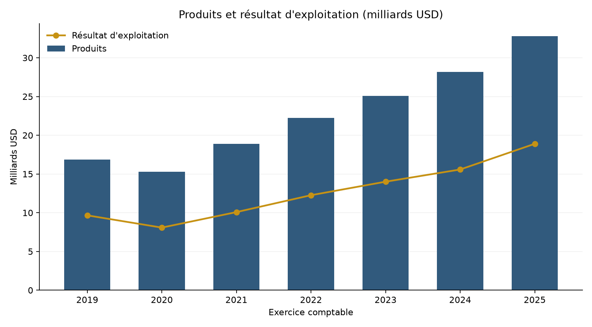
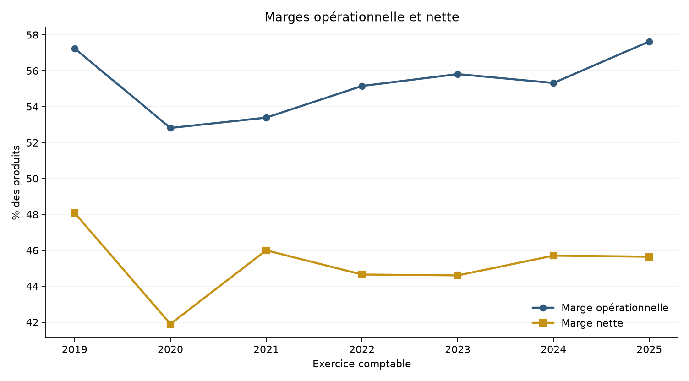
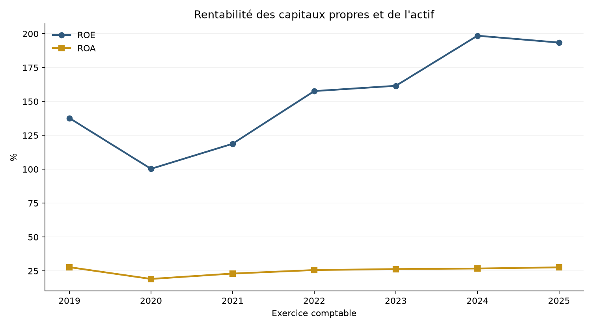
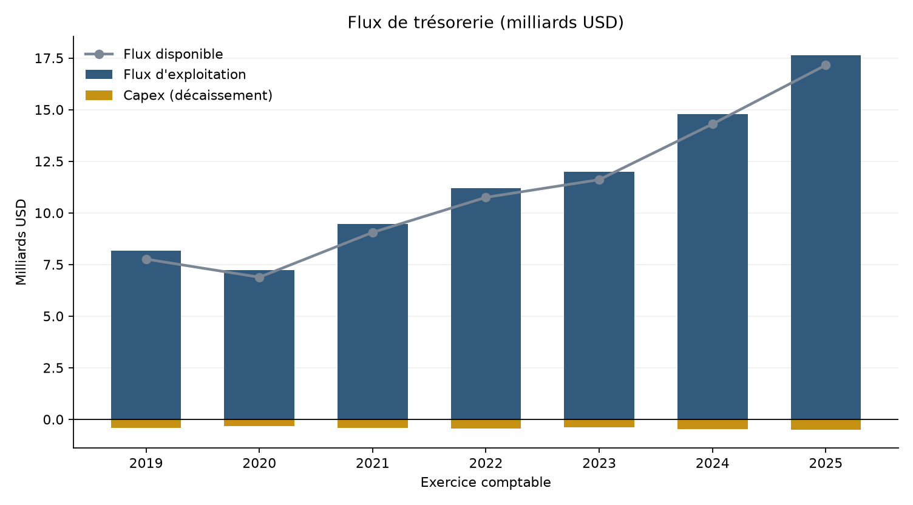

# 06 · Analyse financière de Mastercard

[](../../)

[← Retour à l’index du portfolio](../../)

**Données publiques :** [SEC EDGAR — companyfacts, Mastercard Incorporated, CIK 1141391](https://data.sec.gov/api/xbrl/companyfacts/CIK0001141391.json). La SEC indique que les dépôts publics EDGAR sont réutilisables; son API ne requiert pas de clé. Conditions et référence dans [`data/raw/SOURCE.md`](data/raw/SOURCE.md). Exercices 2019–2025.

## Question de gestion

Comment évaluer la rentabilité, l’efficacité, la liquidité et la structure financière de Mastercard sur sept exercices, et quels leviers de pilotage les ratios consolidés révèlent-ils ? L’étude construit une lecture chiffrée des états financiers, sans recommandation d’investissement.

## Résumé en 60 secondes

<!-- AUTO:SUMMARY_BEGIN -->
- **Période et source :** sept exercices 2019–2025, quinze indicateurs et 105 valeurs extraites des 10-K annuels de la SEC.
- **Dernier exercice :** produits 32,79 Md USD, résultat net 14,97 Md USD, marge opérationnelle 57,63 %, ROE 193,46 %.
- **Structure et trésorerie :** liquidité courante 1,03, passif/actif 85,70 %, flux disponible 17,16 Md USD (52,33 % des produits).
- **Livrables automatisés :** 7 tables Power BI, 15 mesures DAX, 4 pages planifiées, 8 graphiques, 109/109 comparaisons SQL/Python; dashboard manuel à construire.
<!-- AUTO:SUMMARY_END -->

## Données et contrôle qualité

Le fichier source est le JSON companyfacts de la SEC. Chaque indicateur est extrait du dernier dépôt annuel 10-K de période FY, avec clôture au 31 décembre. Quinze indicateurs couvrent le compte de résultat, le bilan et les flux de trésorerie. `results/quality_check.csv` trace treize contrôles : entité, CIK, complétude, doublons, valeurs finies, positivité, cohérence du bilan et rapprochement du BPA.

L’écart d’identité du bilan atteint au plus 126 millions USD, soit moins de 0,5 % de l’actif total; il est traité comme information. Le BPA déclaré s’écarte de moins de 0,07 % du résultat net divisé par les actions diluées.

## Méthode

Le pipeline reconstruit une table de faits annuelle, calcule dix-neuf ratios classés en six catégories (rentabilité, efficacité, liquidité, structure, trésorerie, croissance) et vérifie la parité entre Python et SQL sur 109 indicateurs. Les graphiques sont produits avec Matplotlib; aucun modèle prédictif n’est revendiqué.

Les seuils d’alerte sont des repères de lecture internes au projet, pas des normes sectorielles : marge opérationnelle au moins 40 %, liquidité courante au moins 1,0, passif au plus 80 % de l’actif, couverture des intérêts au moins 8, flux disponible positif et croissance positive.

## Résultats clés

<!-- AUTO:KEY_RESULTS_BEGIN -->
| Indicateur | Résultat | Référence |
|---|---|---|
| Produits 2025 | 32,79 Md USD; croissance 16,42 % | `results/annual_kpis.csv` |
| Marge opérationnelle | 57,63 % en 2025 contre 55,32 % en 2024 | `results/ratio_summary.csv` |
| ROE et ROA | 193,46 % et 27,64 % | `results/annual_kpis.csv` |
| Liquidité et dette | liquidité 1,03; passif/actif 85,70 %; couverture 26,2x | `results/annual_kpis.csv` |
| Flux disponible | 17,16 Md USD, soit 52,33 % des produits | `results/annual_kpis.csv` |
| Parité SQL/Python | 109/109 PASS | `results/sql_parity.csv` |
<!-- AUTO:KEY_RESULTS_END -->

## Recommandations

<!-- AUTO:RECOMMENDATIONS_BEGIN -->
| Priorité | Recommandation | Évidence calculée |
|---:|---|---|
| 1 | Protéger la marge opérationnelle en pilotant la croissance des charges d'exploitation sous celle des produits; conserver le seuil de 40 % comme repère de lecture. | Marge opérationnelle 57,63 % en 2025 contre 55,32 % en 2024; produits 32 791 000 000 USD et résultat d'exploitation 18 897 000 000 USD. |
| 2 | Renforcer le coussin de liquidité: maintenir un ratio de liquidité courante au moins égal à 1,0 et documenter un plan de trésorerie si le passif courant continue de progresser plus vite que l'actif courant. | Liquidité courante 1,03 en 2025 contre 1,42 en 2019; trésorerie 10 566 000 000 USD. |
| 3 | Surveiller le levier financier et la couverture des intérêts lors de chaque nouvelle émission de dette; la baisse des capitaux propres réduit la marge de manœuvre. | Passif/actif 85,70 % en 2025 contre 79,51 % en 2019; couverture des intérêts 26,2x. |
| 4 | Allouer le flux de trésorerie disponible en priorisant la réduction du levier lorsque la couverture des intérêts se dégrade, puis les rachats d'actions. | Flux disponible 17 159 000 000 USD, soit 52,33 % des produits; intensité des investissements 1,49 %. |
| 5 | Confirmer la durabilité de la croissance: la trajectoire récente doit être suivie sur des exercices complets, sans extrapoler un rythme annuel au-delà de la période observée. | Croissance annuelle des produits 11,70 % en moyenne 2019-2025; dernière variation 16,42 %. |
<!-- AUTO:RECOMMENDATIONS_END -->

## Limites

La source ne fournit ni segmentation par activité, ni ventilation géographique, ni détail des rachats d’actions. Les sept exercices constituent une fenêtre courte; les tendances passées ne préjugent pas des exercices futurs. Les ratios dépendent de conventions comptables et ne constituent pas une opinion sur la valeur de l’entreprise.

## Aperçu des graphiques









## Statut qualité

<!-- AUTO:QA_STATUS_BEGIN -->
**Automatisé :** `PASS` selon [`qa/validation_report.md`](qa/validation_report.md). **Manuel Power BI :** à faire par Samuel; aucune validation Desktop n’est revendiquée.
<!-- AUTO:QA_STATUS_END -->

## Dashboard

Quatre pages Power BI sont planifiées dans [`powerbi/PAGE_PLAN.md`](powerbi/PAGE_PLAN.md). Le dashboard reste à construire par Samuel. Aucun PBIX/PBIP, PDF de dashboard ou PowerPoint n’est produit dans cette livraison; les exports PDF/PNG seront effectués après la validation Desktop décrite dans [`powerbi/EXPORT_PREVIEWS.md`](powerbi/EXPORT_PREVIEWS.md).

## Reproduire

```bash
python -m pip install -r requirements.txt
python scripts/run_all.py
```

Cette commande régénère les tables traitées, analyses, ratios, graphiques, base SQLite, contrôles de parité, rapport QA et blocs dynamiques des README/DAX à partir du JSON brut versionné.

## Contenu du dossier

`data/` : source, dictionnaire et tables Power BI. `scripts/` : nettoyage, analyse, ratios, SQL et rapport. `sql/` : schéma et requêtes. `results/` : KPI, contrôles, comparaisons et recommandations. `visuals/` : graphiques Matplotlib. `model/`, `powerbi/`, `qa/` : modèle, DAX, plan de pages et contrôles.
