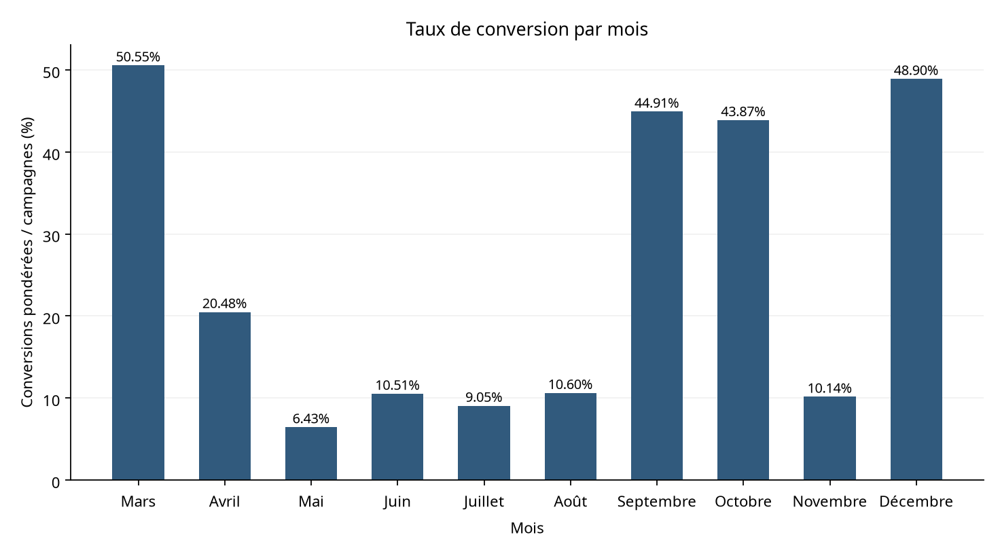
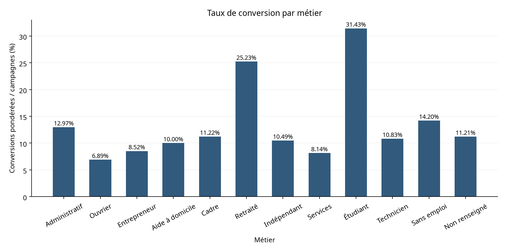
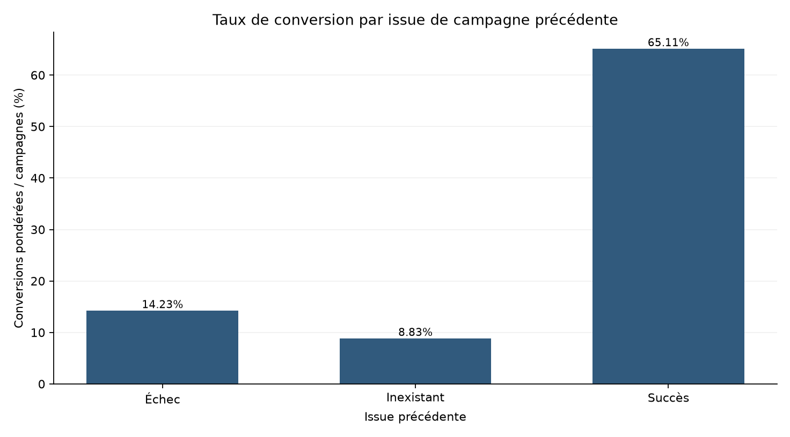
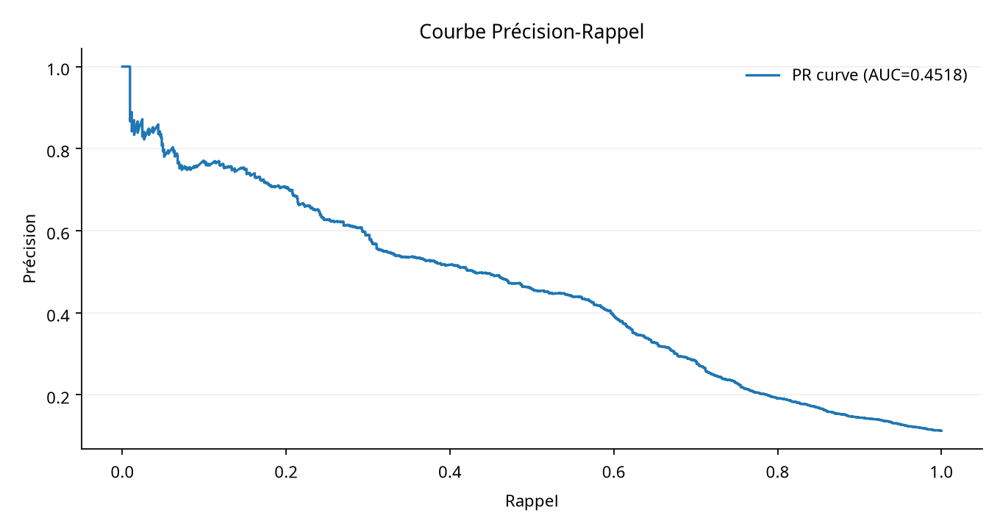

# 07 · Performance marketing d'une banque

[](../../)

[← Retour à l’index du portfolio](../../)

**Données publiques :** [UCI Bank Marketing](https://archive.ics.uci.edu/dataset/222/bank+marketing), sous licence CC BY 4.0. La référence, l'attribution et l'empreinte SHA-256 sont documentées dans [`data/raw/SOURCE.md`](data/raw/SOURCE.md). Le fichier `bank-additional-full.csv` couvre les campagnes de mai 2008 à novembre 2010.

## Question de gestion

Quels segments et contextes de campagne sont associés à une meilleure souscription d'un dépôt à terme, et comment prioriser les contacts sans transformer une corrélation en décision automatique ?

## Résumé en 60 secondes

- **Population :** 41 188 observations de campagne et 4 640 souscriptions, soit 11,27 % de conversion.
- **Signal descriptif :** les observations dont la campagne précédente s'est soldée par un succès affichent 65,11 % de conversion, contre 8,83 % lorsque l'issue précédente est inexistante.
- **Segments :** les groupes 66 ans et plus et 17–25 ans affichent 46,85 % et 20,95 %, avec des volumes très différents.
- **Modèle et SQL :** ROC-AUC 0,7917, PR-AUC 0,4518, F1 0,4903; les cinq contrôles SQL/Python sont PASS.

## Données et contrôle qualité

La source UCI contient 20 variables explicatives et la cible `y`. Les modalités `unknown` sont conservées comme catégories explicites. Les 12 doublons exacts sont conservés pour l'analyse descriptive et regroupés lors de la séparation train/test. Les contrôles de présence des colonnes, de cible, d'âge, de campagne, de durée et d'indicateurs macroéconomiques sont PASS dans `results/quality_check.csv`.

## Méthode

Le pipeline Python nettoie la source, construit une table de faits et neuf dimensions, produit les agrégats et les graphiques, puis entraîne une régression logistique avec séparation groupée stratifiée 70/30. Il reconstruit aussi `data/processed/bank_marketing.db` et compare cinq KPI ou agrégats SQL aux résultats Python. Le seuil est sélectionné sur des prédictions hors pli afin de maximiser le F1. La variable `duration` est exclue du modèle car elle est connue après l'appel et provoquerait une fuite d'information dans une logique de priorisation pré-contact.

Les requêtes SQL de contrôle sont dans `sql/`. Le modèle en étoile, les mesures DAX et le plan Power BI sont documentés dans `model/` et `powerbi/`.

## Résultats clés

| Indicateur | Résultat | Référence |
|---|---:|---|
| Campagnes | 41 188 | `results/overall_kpis.csv` |
| Souscriptions | 4 640 | `results/overall_kpis.csv` |
| Taux de conversion | 11,27 % | `results/overall_kpis.csv` |
| Conversion après issue précédente « succès » | 65,11 % | `results/conversion_by_poutcome.csv` |
| Conversion après 7 contacts ou plus | 4,61 % | `results/conversion_by_campaign_band.csv` |
| Modèle logistique | ROC-AUC 0,7917; PR-AUC 0,4518; F1 0,4903 | `results/model_scorecard.csv` |
| Parité SQL/Python | 5/5 contrôles PASS | `results/sql_parity.csv` |

## Recommandations

1. Utiliser l'issue de la campagne précédente comme signal de suivi commercial, sans l'interpréter comme une causalité.
2. Suivre simultanément le taux et le volume par segment afin de ne pas sur-prioriser les petits groupes.
3. Examiner les campagnes répétées : le taux observé passe de 13,04 % après un contact à 4,61 % pour sept contacts ou plus, mais ce résultat peut refléter un ciblage plus difficile.
4. Utiliser le modèle comme aide au classement pour une revue humaine, jamais comme décision automatique d'offre ou de refus.

## Limites

La source ne fournit pas d'identifiant client unique, de revenu individuel ni de date civile complète. Les modalités `unknown` sont nombreuses. Les taux par âge, métier ou mois sont descriptifs et ne démontrent pas un effet causal. Le modèle n'est pas calibré pour une décision de crédit et ne doit pas être utilisé pour exclure une personne d'une offre.

## Aperçu des graphiques









## Statut qualité

**Automatisé :** `PASS` selon [`qa/validation_report.md`](qa/validation_report.md). **Manuel Power BI :** à faire par Samuel; aucune validation Desktop n’est revendiquée.

## Dashboard

Trois pages Power BI sont planifiées dans [`powerbi/PAGE_PLAN.md`](powerbi/PAGE_PLAN.md). Le dashboard reste à construire par Samuel. Aucun PBIX/PBIP, PDF de dashboard ou PowerPoint n’est produit dans cette livraison; les exports PDF/PNG seront effectués après la validation Desktop décrite dans [`powerbi/EXPORT_PREVIEWS.md`](powerbi/EXPORT_PREVIEWS.md).

## Reproduire

```bash
python -m pip install -r requirements.txt
python scripts/run_all.py
```

Cette commande régénère les tables traitées, la base SQLite, les analyses, graphiques, KPI, contrôles QA et la parité SQL/Python à partir du fichier brut versionné.

## Contenu du dossier

`data/` : source, dictionnaire et tables Power BI. `scripts/` : nettoyage, analyse et modèle. `sql/` : schéma et requêtes. `results/` : KPI, contrôles et métriques. `visuals/` : graphiques Matplotlib. `model/`, `powerbi/`, `qa/` : modèle, DAX, plan de pages et contrôles.
