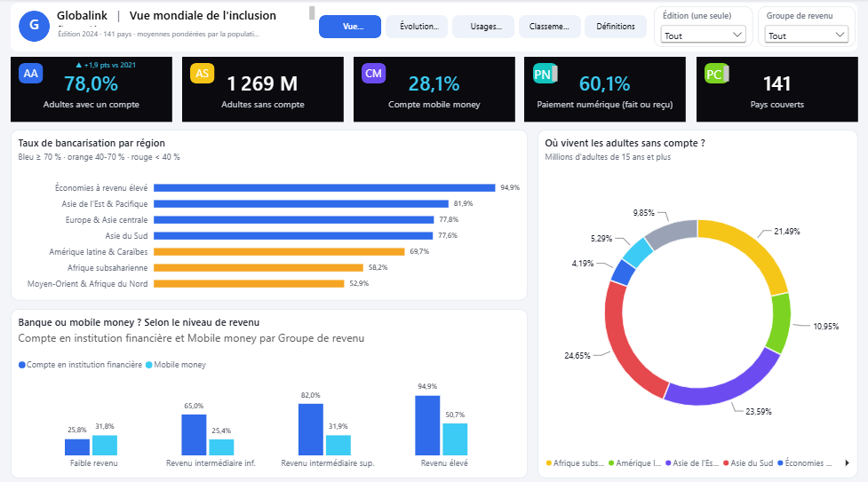

# 08 · Inclusion financière — Global Findex

## Objectif

Cette étude mesure l’accès et l’usage des services financiers à partir du **Global Findex Database 2025** de la Banque mondiale. Elle compare la détention d’un compte, les comptes bancaires, le mobile money, l’épargne, l’emprunt et quelques indicateurs de connectivité. L’analyse couvre les années 2011, 2014, 2017, 2021 et 2024, avec une lecture par pays, région, groupe de revenu et genre.

## Résultats clés

En 2024, la moyenne pondérée par population adulte couverte atteint **78,0 %** pour la détention d’un compte ou l’usage d’un mobile money, contre **50,6 %** en 2011. Le taux de compte bancaire atteint **74,3 %**, tandis que le mobile money atteint **28,1 %**. Ces taux sont calculés sur les lignes pays disponibles et ne remplacent pas les agrégats officiels publiés par la Banque mondiale.

Les écarts régionaux restent importants. En 2024, la détention d’un compte atteint **94,9 %** dans les économies à revenu élevé, contre **52,9 %** au Moyen-Orient et en Afrique du Nord et **58,2 %** en Afrique subsaharienne. L’Afrique subsaharienne présente toutefois le taux de mobile money le plus élevé parmi les régions non riches, à **40,2 %**, ce qui confirme que l’inclusion peut progresser par des canaux différents.

Les fractures entre groupes sont également visibles. L’écart hommes-femmes de détention d’un compte atteint environ **33,8 points** en Algérie dans la comparaison 2024 disponible. L’écart entre les 60 % les plus riches et les 40 % les plus pauvres atteint environ **37,4 points** au Vietnam. Ces écarts sont descriptifs : ils ne prouvent pas une causalité et doivent être lus avec la méthodologie d’enquête.

## Livrables

Le dossier contient le CSV officiel Global Findex 2025, son glossaire, la source documentée, un script d’analyse reproductible, les tables de résultats et les contrôles qualité. Le dashboard Power BI place désormais **Fractures d’accès** en page d’accueil : classements des écarts femmes–hommes et riches–pauvres, comparaison régionale descriptive, et précautions méthodologiques visibles. Les vues d’ensemble, comparaison pays et tendances restent accessibles dans la navigation.

Dashboard **Power BI** ([dossier `dashboard/powerbi/`](dashboard/powerbi/)) : rapport PBIP multi-pages (navigation, segments, KPI, analyses détaillées). Ouvrir le fichier `.pbip` avec Power BI Desktop, régler le paramètre `DossierDonnees`, puis actualiser — voir [`dashboard/powerbi/README.md`](dashboard/powerbi/README.md).



## Reproduction

Depuis le dossier du projet :

```bash
python3 -m pip install -r requirements.txt
python3 scripts/01_analyze.py
python3 -m http.server 8000
```


## Méthode et limites

Le fichier officiel contient des estimations par pays, année et sous-groupe. Les agrégations régionales et mondiales de ce projet sont des moyennes pondérées par `pop_adult` sur les lignes pays `group=all` et `group2=all`. Le nombre de pays couverts varie selon l’année et l’indicateur. Les proportions concernent les adultes de 15 ans et plus.

La détention d’un compte, l’usage d’un mobile money, les paiements numériques, l’épargne et l’emprunt sont des indicateurs distincts. Une hausse de la détention d’un compte ne démontre pas que les services sont abordables, utilisés régulièrement ou adaptés aux besoins. L’étude ne construit pas de score causal, de classement de développement ou de recommandation opérationnelle automatique.

## Sources

- [Global Findex 2025 — page officielle](https://www.worldbank.org/en/publication/globalfindex)
- [Téléchargement officiel des données](https://www.worldbank.org/en/publication/globalfindex/download-data)
- [CSV GlobalFindexDatabase2025](https://thedocs.worldbank.org/en/doc/be6615202d1f08a25855c8ac2d615122-0050012025/related/GlobalFindexDatabase2025.csv)
- [Glossaire Global Findex 2025](https://thedocs.worldbank.org/en/doc/be6615202d1f08a25855c8ac2d615122-0050012025/related/GlobalFindex2025-glossary.xlsx)
- [Méthodologie d’enquête](https://thedocs.worldbank.org/en/doc/be6615202d1f08a25855c8ac2d615122-0050012025/related/Survey-methodology.pdf)
- [Data360 — Global Findex Database](https://data360.worldbank.org/en/dataset/WB_FINDEX)
