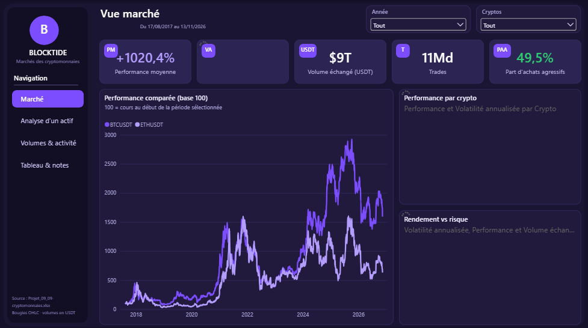

# Cryptomonnaies — BTC/ETH OHLC

## Projet 9

Analyse descriptive et comparative de Bitcoin et Ethereum sur données Spot quotidiennes publiques de Binance.

## Statut

Pipeline de données, analyse, visualisations et rapport initialisés. Les chiffres sont régénérables avec les scripts du dossier `scripts/`.

## Livrables

Dashboard **Power BI** ([dossier `dashboard/powerbi/`](dashboard/powerbi/)) : rapport PBIP multi-pages (navigation, segments, KPI, analyses détaillées). Ouvrir le fichier `.pbip` avec Power BI Desktop, régler le paramètre `DossierDonnees`, puis actualiser — voir [`dashboard/powerbi/README.md`](dashboard/powerbi/README.md).



## Reproduction

```bash
pip install -r projects/09-cryptomonnaies/requirements.txt
python projects/09-cryptomonnaies/scripts/fetch_data.py --start 2017-01-01
python projects/09-cryptomonnaies/scripts/analyze.py
python projects/09-cryptomonnaies/scripts/build_dashboard_data.py
```

Les données sont récupérées sans clé API depuis l’endpoint public Binance Spot. Cette analyse est descriptive et ne constitue pas un conseil financier.
